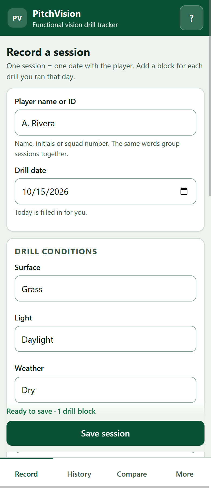
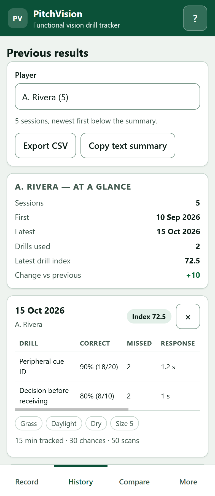
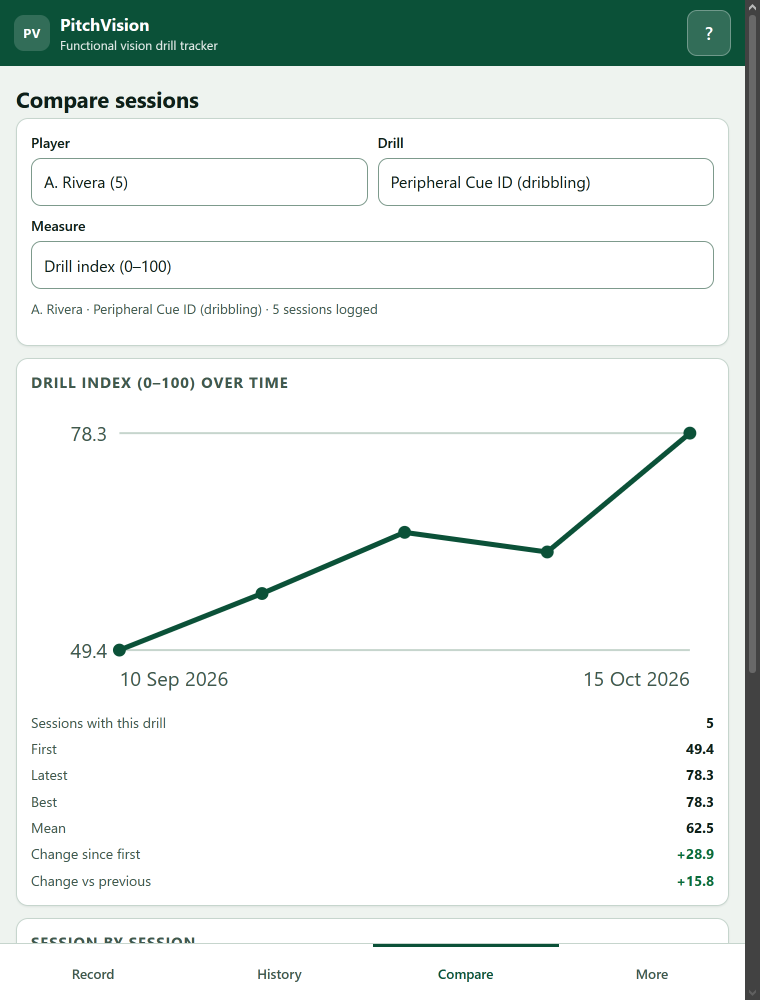

# PitchVision

**A field-side web app for logging repeatable soccer drills and tracking how a player uses visual information while moving — peripheral cue identification, scanning, and decisions before receiving.**

> **Drill performance only.** PitchVision records what happened in a drill on a given day. It is **not** a medical diagnosis, it does **not** measure eyesight or screen for vision problems, and it is **not** a substitute for an eye-care assessment. If a player or a parent is worried about vision, refer them to an optometrist or ophthalmologist.

Live demo: <https://nashvilleaiclub.com/demo/abanerji/pitch-vision/>





*Screenshots show example sessions, not real players.*

---

## What it does

1. **Record** — player name or squad number, drill date, conditions (surface, light, weather, ball), then one block per drill you ran.
2. **History** — every session ever logged for that player, oldest to newest, with a plain table of correct / missed / response time / scans per minute / passes / index.
3. **Compare** — pick a player, a drill and a measure, and see the trend line, the change since the first session and the change since last time.
4. **More** — how to run the app, the drill protocols, a JSON back-up / restore, CSV export and the full disclaimer.

Everything runs in the browser. No accounts, no sign-in, no server, no analytics, no network calls after the page loads. A session logged on the pitch stays on that device until you export it.

## The drills

| Drill | What the player does | What you log |
|---|---|---|
| **Peripheral Cue ID (dribbling)** | Dribbles a 20 m corridor while an assistant shows numbered/coloured cues in the far periphery; calls each cue without turning their head | cues shown, correct calls, mean response time, head scans, duration |
| **Decision Before Receiving** | A cue is shown as the ball is served; the player calls the decision before the first touch and plays it | trials, correct decisions, mean decision time, pre-receive scans, passes attempted/completed, duration |
| **Scanning & Awareness (small-sided)** | 4v4/5v5 with neutrals; an observer counts the target player's head scans and whether the ball action matched what they had scanned | possessions observed, good decisions, scans (required), optional mean time to release, duration |
| **Other drill** | Your own repeatable drill | name, chances, correct responses, optional response time and scans, duration |

Each protocol is also written out inside the app (More → *The drills*).

## What is recorded — and what is not

Recorded per session: player label, date, the four condition fields plus one short notes line, and for each drill block the counts and times above. That is all.

Not recorded: video, photos, birth dates, medical history, contact details, or anything about a player's eyes. There is no free-text field large enough to paste a diagnosis into.

## How the numbers are worked out

- **Accuracy** = correct ÷ chances presented.
- **Missed** = chances presented − correct (derived, never typed in).
- **Scans per minute** = head scans ÷ block duration, so a 4-minute and a 12-minute block compare fairly.
- **Drill index (0–100)** = accuracy 50% + response time 30% + scanning 20%, with the weights re-balanced when a measure was not recorded. The response-time part is the drill's par time ÷ the measured time (100 at par, 50 at twice par). A drill with neither a response time nor scans falls back to accuracy. This is a within-session coaching summary, not a clinical score.

## Input validation

Nothing is stored until every field passes. The save button stays disabled and each problem is written next to the field it belongs to.

- Player name or ID: required, 1–48 characters, at least one letter or number.
- Date: required, must be a real date, not in the future, not before 2000.
- Whole numbers only where a count is expected (`20` yes, `1.5` or `20 cues` no).
- Ranges: duration 0.5–180 min, response time 0.05–20 s, chances 1–500.
- Correct answers cannot exceed chances presented; completed passes cannot exceed passes attempted.
- Scan counts above 120 per minute are refused as a probable mis-count or a wrong duration.
- Notes: 140 characters, block and conditions alike.
- Imports: the file is validated record by record; bad records are skipped with a count, and a file from a newer version is refused.

## Running it

**Prerequisite:** Node 18+ *only* for the optional local server and the tests. The app itself is plain HTML/CSS/JavaScript and needs nothing installed.

```bash
# On a laptop (serves the folder, no dependencies)
npm start                 # → http://localhost:8080/
# or
node tools/serve.mjs 8080
HOST=0.0.0.0 node tools/serve.mjs 8080     # reachable from a phone on the same wi-fi

# Tests (51 assertions, no dependencies)
npm test

# Check the deployed copy through the CDN
npm run verify -- https://nashvilleaiclub.com/demo/abanerji/pitch-vision/

# After changing any file: bump the asset version, then redeploy
npm run bump          # rewrites ?v=N in index.html and every import in src/*.js
npm run check         # fails if those versions ever disagree
```

**Why the version bump matters.** The origin sends `Cache-Control: immutable,
max-age=2592000` for static files, so the CDN and the browser cache `app.js`
under its own URL for 30 days while the HTML is never cached. Without a new
`?v=` a returning visitor would keep running the old code. `tools/bump-version.mjs`
bumps it in one place and `npm run check` refuses a half-bumped tree (a module
imported under two different query strings would be instantiated twice).

**On the pitch:** open the live URL on your phone, then *Share → Add to Home Screen*. It opens full screen and keeps working with no signal once loaded. Data lives in that browser; export a JSON back-up before changing phone, browser or clearing site data.

Opening `index.html` straight off disk with `file://` will not work in Chrome — ES modules are blocked on that origin. Use the local server, or the live URL.

## Tests

```
ℹ tests 51
ℹ pass 51
ℹ fail 0
```

`tests/metrics.test.js` checks the derived maths against hand-computed values and asserts *relationships* (a faster or more accurate session can never score lower, the index stays inside 0–100, weights re-normalise). `validate.test.js` covers every rule above including the cross-field ones. `stats.test.js` covers grouping, series weighting, chart geometry and deltas. `csv.test.js` proves the exported file is well formed with a quote-aware reader. `storage.test.js` covers round-trips, corrupt data, blocked storage and the merge-on-import rules.

## Project layout

```
index.html            four-tab shell
src/drills.js         the drill catalog — every stored measure is declared here once
src/metrics.js        derived measures (pure functions)
src/stats.js          grouping, series, deltas, chart geometry (pure)
src/validate.js       parsing, ranges, cross-field rules, session building (pure)
src/csv.js            CSV export and the text summary (pure)
src/storage.js        localStorage repo behind an injectable adapter
src/app.js            the interface (the only file that touches the DOM)
src/styles.css        mobile-first, daylight-readable
docs/                 screenshots used above
tools/serve.mjs       zero-dependency static server
tools/bump-version.mjs      cache-busting version for every asset URL
tools/verify-deployed.mjs   live-deploy check through the CDN
tests/                node:test suite, run by tests/run.js
```

## Deploying the demo

The `nashvilleaiclub.com` docroot is shared by the multisite, so a directory in `demo/abanerji/pitch-vision/` answers on both the live and the stage host at the same path.

```bash
npm run bump   # only when the code changed
tar czf /tmp/pitch-vision.tar.gz index.html src tools package.json README.md LICENSE
scp /tmp/pitch-vision.tar.gz <host>:~/ && ssh <host> '
  D=<docroot>/demo/abanerji/pitch-vision
  mkdir -p "$D" && tar xzf ~/pitch-vision.tar.gz -C "$D"
  chown -R www-data:www-data "$D"'
npm run verify   # fetches every asset with ?v=<n> as a browser would
```

## Known limits

- One device, one browser: there is no sync between phones (by design — no accounts, nothing stored server-side).
- The response-time figure is stopwatch-accurate at best. Use the tap timer on a handful of reps rather than timing a whole block by hand.
- The drill index compresses three different things into one number; read it next to the individual measures, not instead of them.
- Sessions logged before a rule change are kept as they were entered; the app validates new entries only.

## License

MIT — see [LICENSE](LICENSE).
